# Gracious Ehi

I build complete software products: the apps, the backend, the database, the AI and the tests. I've built multi-tenant SaaS for gyms and small businesses, native iPhone apps with AI companions, a multi-faith companion that answers only from reviewed scripture, a compliance assessment tool, a Rust desktop tool that works at the operating-system level, my own harness for AI coding, an AI marketing platform and a care marketplace.

I'm Ikhine Gracious Osezuwa, a founder and engineer based in Slovenia. I work with Claude Code and Codex.

The code is private, so this page shows what each product does and how it's built. If you're reviewing my work, ask me for read access.

## FitForge

Gyms have the hardware. FitForge gives them the software, and the gym sets the price its members pay.

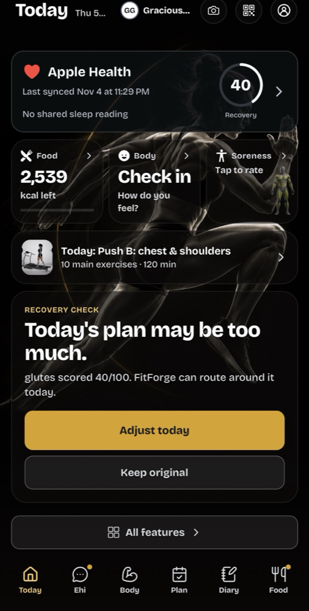 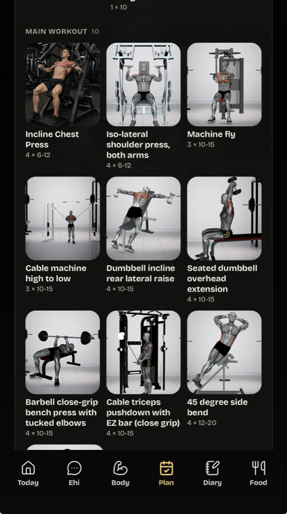 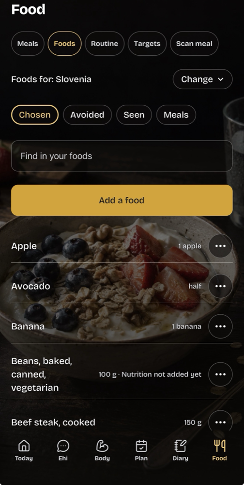 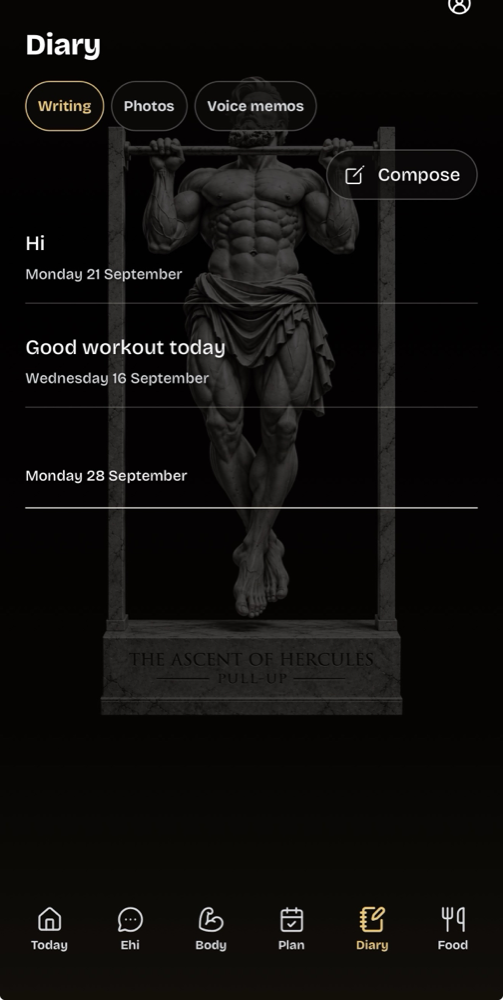

A gym sends its equipment catalog, and every member gets a training plan built from the machines that gym actually has, in the gym's own branding. Members get a workout runner, an AI coach, a food diary they can fill in by voice, text or photo, progress photos with an AI body-fat estimate, recovery tracking on a body map, and sleep and activity data from Apple Health, Health Connect, Oura and Strava. Gym owners get a dashboard for members, equipment, locations, the front desk, challenges and billing, with PDF invoices, CSV export and a widget for their own website. People who don't belong to a gym can train on their own.

It runs on the web, iOS and Android, and it is my largest codebase: over a million lines of TypeScript and SQL in more than 5,000 files and 1,000 folders, with over 2,000 test files and 264 database migrations.

Built with Next.js 16, TypeScript, Neon Postgres with row-level security between gyms and between members, Better Auth, Cloudflare R2, and Expo (React Native) for iOS and Android with over-the-air updates. On every change, CI typechecks and lints the code, runs the unit and integration tests in three shards and builds the web and mobile apps. Playwright end-to-end tests and database isolation tests run against a test database, a monitor checks the live security headers every six hours, and every paid AI call runs behind a cost circuit breaker.

## Tools for building with AI

### Wipeproof

Never lose important work to an AI agent again.

When an agent runs `rm -rf`, `git reset --hard` or `Remove-Item`, your files skip the Trash and are gone for good. Wipeproof catches every delete at the operating-system level, keeps an encrypted copy in a cloud bin on Backblaze B2, and you restore it from the desktop app. It works below the agent, so it protects you from every program on the machine, and only you can empty the bin. In a stress test it saved a correct copy of all 1,000,000 files.

Built with an 11-crate Rust workspace that forbids unsafe code, macOS Endpoint Security, a Tauri and React desktop app, and an account service in Next.js with Better Auth and Postgres.

### AI Multimodal Harness

My own harness for AI coding work. It watches a session's quality and cost while it runs, and moves the work to a fresh session before a bad one costs you.

Long AI sessions drift: they forget rules, repeat failed fixes and redo finished work, and every message costs more as the history grows. The harness scores each session as it runs. It keeps a handoff ready from the first message, and when a session goes bad it moves the work to a fresh session with a private Git bundle and a full recovery archive, so nothing unfinished is lost. A router picks the model that suits each task, cheaper or stronger. Approved tasks run in their own sessions and Git worktrees and must pass verification before the main code changes. A second model can judge the work, and each project keeps one long-term memory across sessions.

Built with TypeScript on Bun, with more than 3,800 tests.

## Companion apps for faith and health

### Faith Companion

A companion for people of faith that answers from their own scripture and never invents doctrine.

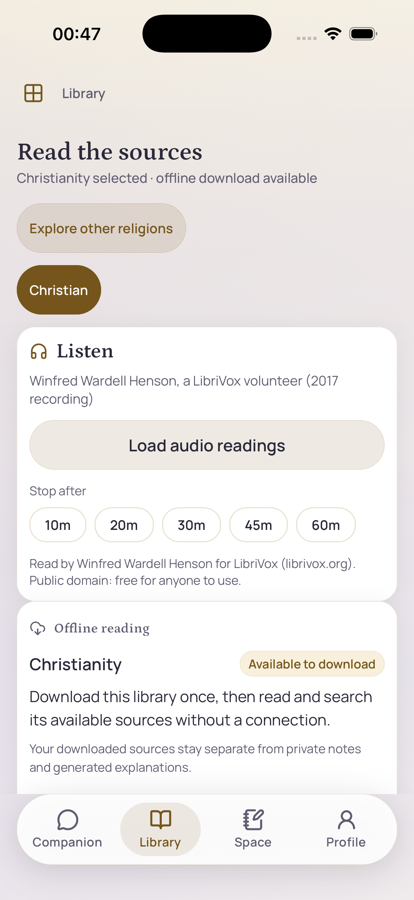

It runs on iPhone, Android and the web and covers ten religions (Bahá'í, Buddhism, Christianity, Daoism, Hinduism, Islam, Jainism, Judaism, Shinto and Sikhism) and a wisdom collection. A person describes what they feel, what they are going through or what they want to understand, and Ehi, the companion, answers from that person's own religion: reviewed scripture, prayers and practices, each with its source. The AI can find, organise and simplify reviewed sources, but it cannot invent doctrine or citations. Scripture arrives in signed packs that work offline, private notes stay on the phone, and messages about abuse, self-harm or danger are met with safety help.

Built with Next.js, Expo (React Native), Neon Postgres, SQLite and Cloudflare R2 for the signed source packs and audio, with 145 automated test gates.

### Ehi: GLP Companion

A GLP-1 companion on the App Store: doses, refills, weight, meals and a report for the doctor.

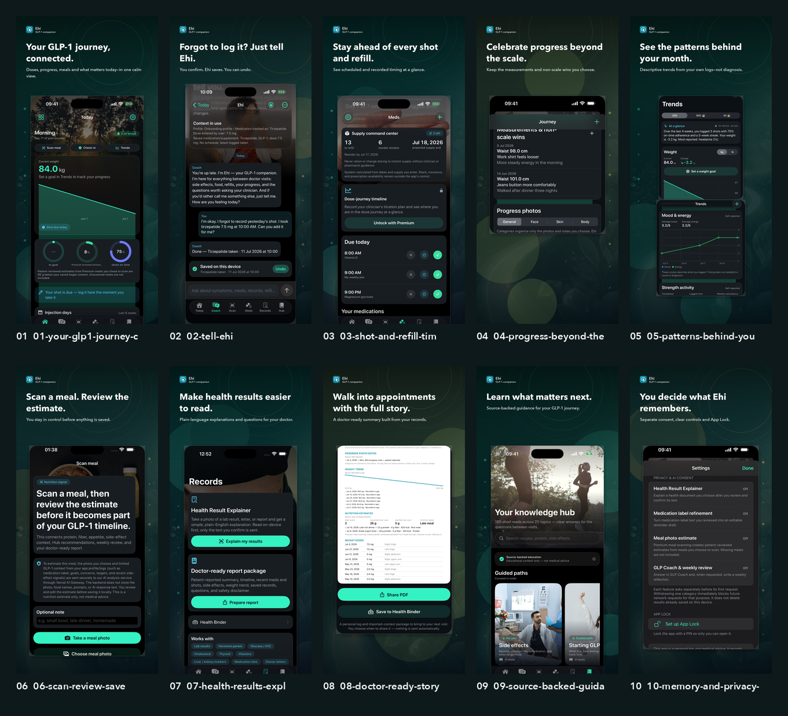

It logs each dose with injection-site rotation, shows when the next refill is due, follows weight and side-effect trends, scans meals with the camera, explains health documents in plain language and builds a report for the doctor. Ehi, the AI companion, checks in morning and evening and answers in the user's own language. Health logs stay on the phone and in the user's private iCloud, and the AI only receives what the user agrees to send.

Built with SwiftUI, SwiftData, StoreKit 2, HealthKit, App Attest and Sign in with Apple, plus a TypeScript backend on Vercel and Neon Postgres. Ehi's behaviour, the meal scan and the record explainer each have their own evaluation tests.

[View on the App Store](https://apps.apple.com/app/ehi-glp-companion/id6782233503)

### Maya: Menopause Companion

A menopause companion on the App Store that takes every symptom seriously.

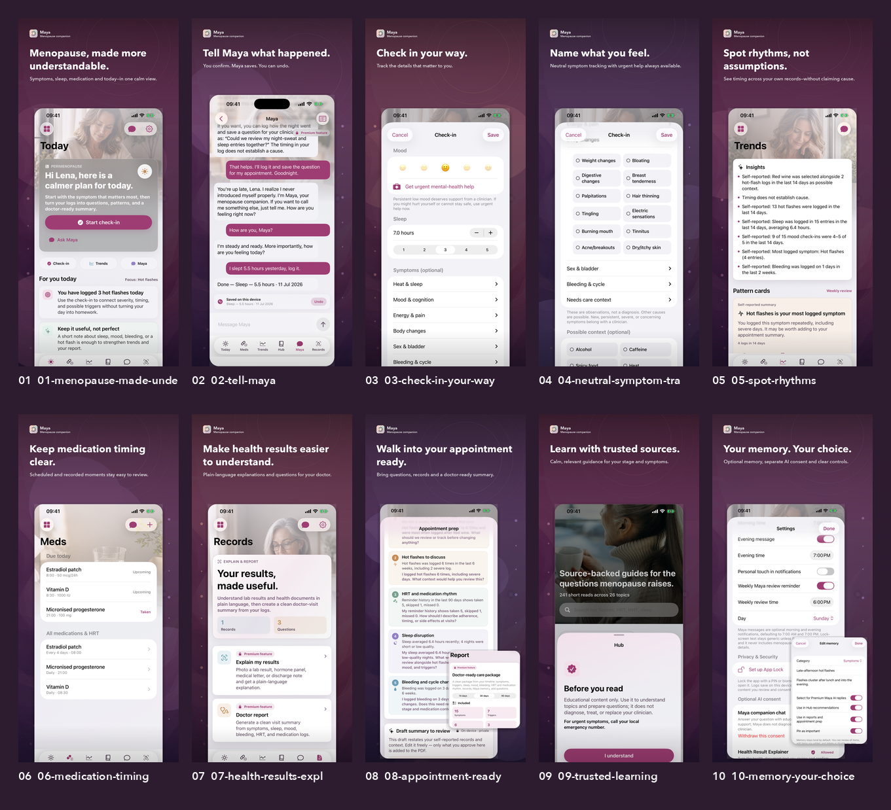

It tracks hot flashes, more than 20 symptoms, sleep, mood, bleeding and HRT, including schedules for patches and cyclical treatment. It explains health results (the text is read on the phone, and only the part the user confirms is sent), helps prepare for appointments and builds a doctor-ready report. The knowledge hub holds 241 cards in 26 categories, and Maya, the AI companion, starts by taking dismissed symptoms seriously.

Built with SwiftUI, SwiftData with private iCloud sync, StoreKit 2, Sign in with Apple, App Attest and a Fastify backend on Neon Postgres.

[View on the App Store](https://apps.apple.com/app/maya-menopause-companion/id6782234202)

### Rebirth

A private postpartum recovery companion for iPhone.

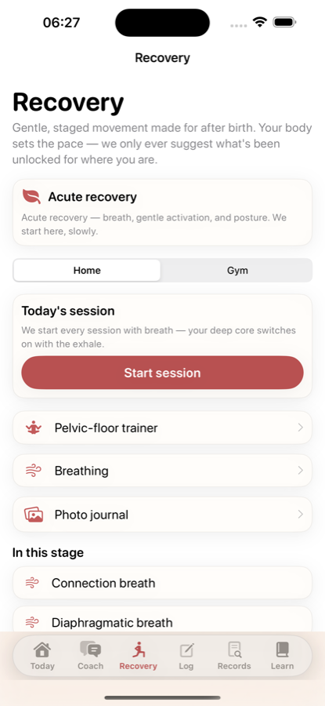

It logs recovery, feeding, sleep and mood, guides staged recovery exercises, sends gentle reminders and prepares a clear summary for check-ups. Ehi, the AI companion, answers in the user's own language, and the red-flag safety checks work in eight languages. No account is needed, and logs stay on the phone and in the user's private iCloud.

Built with SwiftUI, SwiftData, StoreKit 2 and App Attest, with widgets and an Apple Watch app.

## Business software and marketplaces

### Viktoria Compliance

A free GDPR and NIS2 readiness check for small businesses in the EU, in 12 languages.

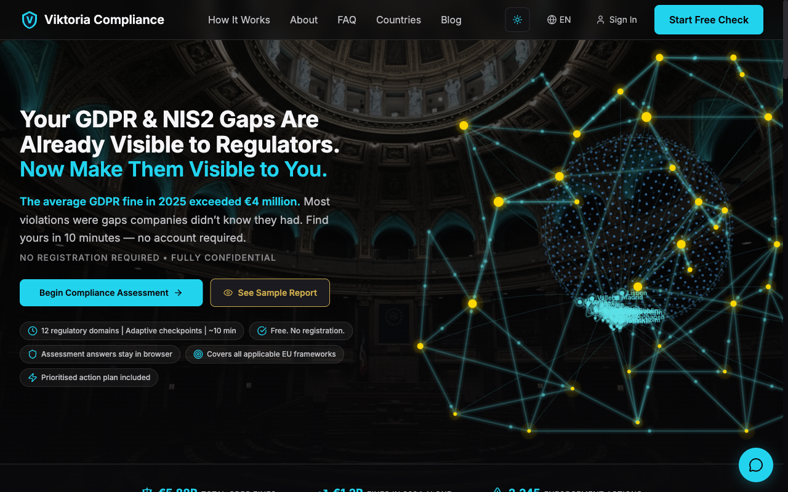

It picks from 119 questions across 13 modules, covering GDPR, NIS2, DORA, ePrivacy and the EU AI Act. The questions depend on the company's size, its sector and the laws that apply to it, and follow-up questions open when an answer calls for them. It scores the answers and produces a PDF report with priority recommendations and next steps, with guidance for 14 EU countries and ready-made compliance templates.

Built with Next.js 15, React 19, Supabase (auth, and Postgres with row-level security on every table), Sanity CMS, i18next and jsPDF.

[viktoria-compliance.eu](https://viktoria-compliance.eu)

### Clinic Revenue OS

Software that helps a private clinic stop losing patients and revenue.

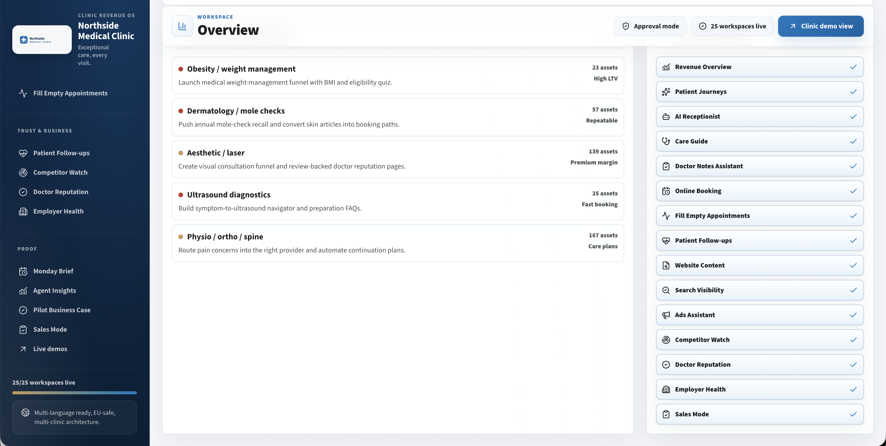 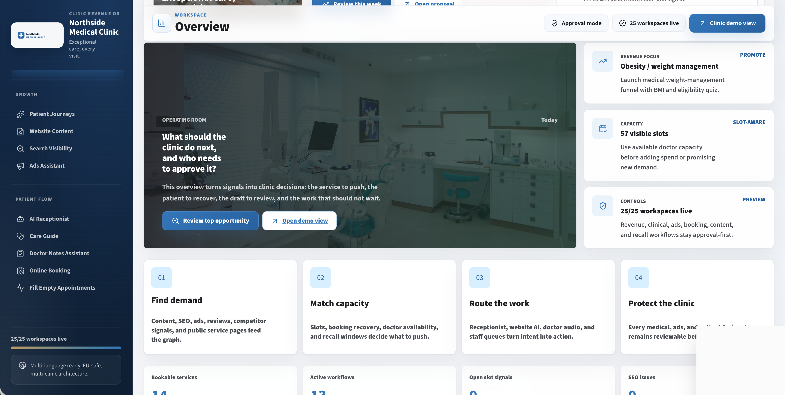 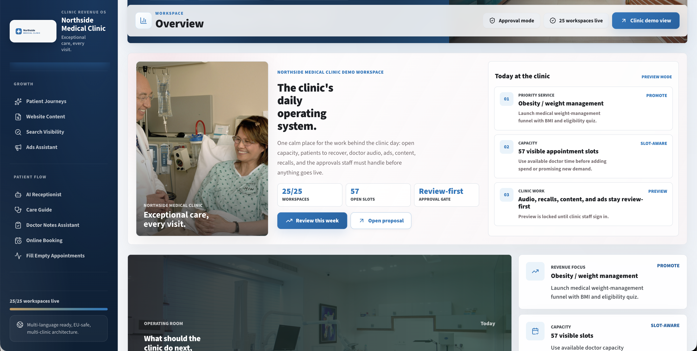

It follows each patient from first enquiry to a booked visit, recalls patients who are due back, fills cancelled slots from a waitlist and shows where revenue is being missed. An AI receptionist answers the phone in English or the preferred language, and outgoing messages and ads pass a medical-advertising compliance check before they are sent. It connects to the clinic's booking and billing systems.

Built with TypeScript, Hono, React (Vite), Drizzle on Neon Postgres, Better Auth and Zod, with a voice service on Twilio, Deepgram speech-to-text and Azure text-to-speech.

### HejMuse

An AI marketing platform that writes in a brand's own voice.

It learns the voice from the brand's website, writes posts in that voice and publishes them to X, LinkedIn, Facebook and Instagram. It also runs an AI newsroom for X: it follows AI news sources, checks each story against independent sources, drafts a post and publishes only after I approve the exact text.

Built with Python (FastAPI, SQLAlchemy, LiteLLM, Redis), Next.js and a browser extension.

### Care Marketplace

A marketplace for care help, built for Europe.

Families find and book helpers, set up repeat visits, pay in the app, leave reviews and share a person's care with a family circle. Helpers and care organisations offer their services, chat with families and see their earnings. People can also buy and sell care equipment. The rules for each country live in their own country pack.

Built with Next.js, Expo (React Native), PostgreSQL and an integrated payment gateway.

### White-label B2B suite

Fifteen B2B products built to be sold under a partner's name.

They live in one Turborepo monorepo: revenue operations, RevOps and DevOps command centres, a brand engine, a real-estate OS, hiring, legal documents, video, AI customer support, people operations, finance operations, a deal room, sales enablement, a knowledge hub and local growth. They share packages for AI, payments, UI and white-labelling.

### AI business tools

More than 90 small AI tools for businesses behind one storefront.

Among them an email rewriter, a job-description generator, a contract analyzer, RFP and proposal writers and a real-estate toolkit. They share packages for AI, payments and UI.

## Repositories

If I have given you read access, this is where each product lives.

| Repository | Product |
| --- | --- |
| `fitforge` | FitForge |
| `wipeproof` | Wipeproof |
| `ai-multimodal-harness` | AI Multimodal Harness |
| `faith-companion` | Faith Companion |
| `faith-companion-early-foundation` | The first version of Faith Companion |
| `glp1-tracker` | Ehi: GLP Companion |
| `menopause-tracker` | Maya: Menopause Companion |
| `rebirth-postpartum-tracker` | Rebirth |
| `viktoria-compliance` | Viktoria Compliance |
| `clinic-revenue-os` | Clinic Revenue OS |
| `hejmuse` | HejMuse |
| `care-marketplace` | Care Marketplace |
| `white-label-b2b-saas-suite` | White-label B2B suite |
| `ai-business-tools-marketplace` | AI business tools |

## Stack

| Area | Tools |
| --- | --- |
| Languages | Swift, TypeScript, Python, Rust, SQL |
| Mobile | SwiftUI, SwiftData, StoreKit 2, HealthKit, App Attest, Expo, React Native |
| Web and backend | Next.js, React, Fastify, FastAPI, Tauri, Bun |
| Data and infrastructure | PostgreSQL (Neon, Supabase) with row-level security, SQLite, Redis, Vercel, Cloudflare R2, Backblaze B2, GitHub Actions |
| AI | Model routing, evaluation tests, tool-using agents, multi-agent pipelines, answers grounded in reviewed sources, safety checks |

## Contact

[LinkedIn](https://www.linkedin.com/in/ikhine-gracious-osezuwa-51259b147/)
